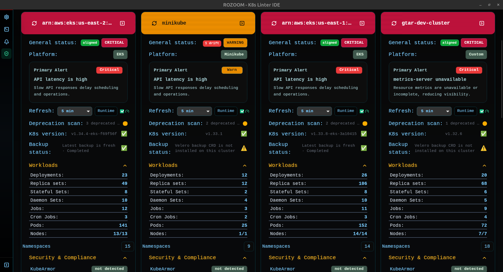

<p align="center">
  
</p>

<p align="center">
  <a href="https://github.com/ceh13-community/rozoom/releases/latest"></a>
  <a href="https://github.com/ceh13-community/rozoom/actions/workflows/cicd.yml?query=branch%3Amain"></a>
  <a href="LICENSE"></a>
  
</p>

<p align="center">
  
</p>

<p align="center">
  <strong>Kubernetes clarity. Without the friction.</strong> — a desktop IDE that shows platform engineers and DevOps teams what is actually happening in their clusters, with no black box between them and the API server.
</p>

<p align="center">
  Built with <strong>Tauri</strong> and <strong>SvelteKit</strong>, ROZOOM combines real-time runtime health signals with configuration risk scoring in a single cross-platform desktop app.
</p>

---

## 30-second quickstart

1. Download the installer for your OS from the [latest release](https://github.com/ceh13-community/rozoom/releases/latest):
   - **macOS** — `.dmg` (Apple Silicon)
   - **Linux** — `.deb` or `.rpm` (x64)
   - **Arch Linux** (no AUR package yet) — build it from the repository: `git clone --depth 1 https://github.com/ceh13-community/rozoom.git && cd rozoom/packaging/arch && makepkg -si` (details in [packaging/arch](packaging/arch/README.md))
   - **Windows** — `.msi` or `.exe` installer (x64)
2. Install and launch ROZOOM. No sign-in, no cloud account.
3. On the first screen, **Manage Kubernetes Clusters**, pick your path:
   - **Local cluster**: open **Connect Cluster** at the bottom of the page and click **Scan local clusters**. A read-only scan finds minikube, kind, k3d and Docker Desktop, then **Connect** on a row adds that cluster.
   - **Remote cluster**: in the same panel pick **Bearer Token** and paste the API server **URL + a service-account token**. No OIDC setup, no kubeconfig editing. The token must be allowed to list nodes: with only the built-in `view` role the app shows the cluster as offline.
   - **Existing kubeconfig**: contexts from `~/.kube/config` (and `$KUBECONFIG`) are listed under **Detected kubeconfig files**, ready to check and add. OIDC, cloud import, exec plugins and Vault are in **Connect Cluster**.

You're now looking at fleet health, Helm releases, and triaged workloads across every connected cluster. RBAC risks come with the free **Security Suite** plugin: enable it under **Marketplace > Plugin Marketplace**.

**Full user documentation:** https://rozoom.app/docs

> **macOS:** builds are unsigned and not notarized, so macOS blocks the app on first launch. Launch it once and click Done, then open System Settings > Privacy & Security, scroll to Security and click **Open Anyway**. Launch ROZOOM again and click Open. macOS remembers the choice. Do not remove the quarantine attribute with `xattr`: it strips a system protection from the whole bundle.

Something confusing or broken? [Tell us what's wrong](https://github.com/ceh13-community/rozoom/discussions).

---

## Nothing runs on your cluster

ROZOOM is **client-side only**. There is no agent, no operator, no DaemonSet, and nothing to `helm install` before you can connect. The app talks to the Kubernetes API server directly from your machine — the same way `kubectl` does — using the credentials you provide. Disconnect, and nothing is left behind.

---

## Repository Structure

```text
.
├── dashboard-app/        # Tauri + SvelteKit desktop application
└── README.md             # Repository overview (this file)
```

The primary application lives in `dashboard-app/`. See the detailed developer guide there for local development, build, and release steps.

---

## What this project delivers

- **Frictionless connection**: auto-detect local clusters or paste a URL + token for remote ones — connected in under a minute, with nothing installed on the cluster.
- **Runtime Health Score**: shows what is failing right now across control plane, nodes, workloads, observability, and platform hygiene.
- **Config Reliability & Security Score**: highlights configuration risks that can cause incidents.
- **Actionable remediation**: top issues are ranked by impact with minimal fix guidance.
- **Cross-platform desktop app**: Linux, macOS, Windows via Tauri.

---

## Building from source

### 1) Install prerequisites

- Node.js ≥ 20
- pnpm
- Rust (stable)
- Tauri system dependencies (see https://tauri.app/v2/)

### 2) Run the app locally

```bash
cd dashboard-app
pnpm install
pnpm format
pnpm run check
pnpm vitest
pnpm download:binaries
pnpm tauri dev
```

For full developer documentation and build steps, read `dashboard-app/README.md`.

---

## Contributing

We welcome contributions that improve cluster visibility, reliability scoring, and user experience.

### How to contribute

1. Fork the repository
2. Create a feature branch
3. Make your changes with tests and documentation
4. Submit a Pull Request with a clear description of impact

### Contribution focus areas

- New runtime health signals (API, etcd, node conditions, workloads)
- Config risk checks and scoring improvements
- UI/UX improvements to surface risk and remediation clarity
- Performance optimizations and request minimization

---

## Versioning

The desktop application follows **Semantic Versioning**.

- **MAJOR**: breaking changes in app behavior or configuration
- **MINOR**: new features or significant enhancements
- **PATCH**: fixes and small improvements

The current version is defined in:

- `dashboard-app/src-tauri/tauri.conf.json`
- `dashboard-app/src-tauri/Cargo.toml`

---

## License

The ROZOOM core is licensed under the Apache License 2.0. See [LICENSE](LICENSE) for details.

The bundled command-line tools (kubectl, Helm and the others) and the libraries the app is built from are distributed under their own licenses, listed with their texts in [THIRD-PARTY-LICENSES.md](THIRD-PARTY-LICENSES.md). The same file ships inside every installer.

Marketplace plugins may be subject to their own license terms.

Copyright (c) 2024-2026 ROZOOM contributors.

ROZOOM and the ROZOOM Logo are unregistered trademarks of the ROZOOM contributors.

Kubernetes® and the Kubernetes logo are registered trademarks of The Linux Foundation in the United States and other countries. ROZOOM is not affiliated with, endorsed by, or sponsored by The Linux Foundation or the Kubernetes project.
